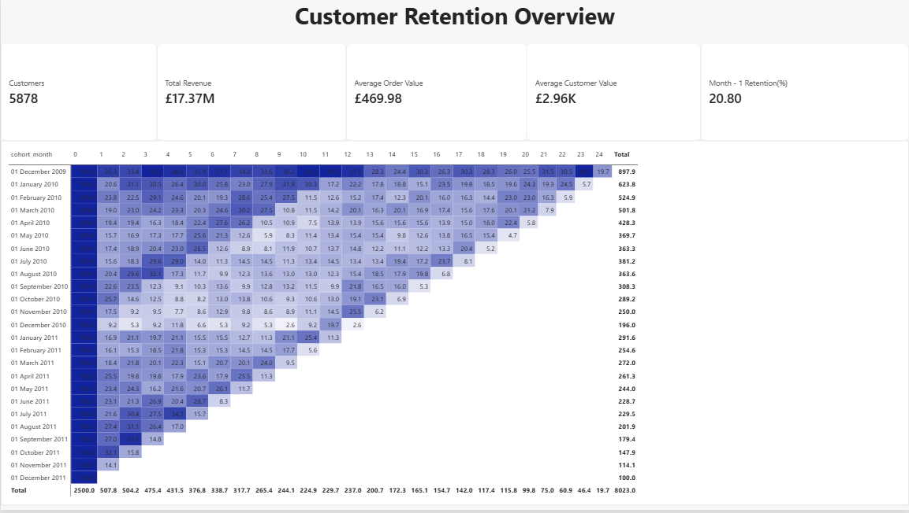
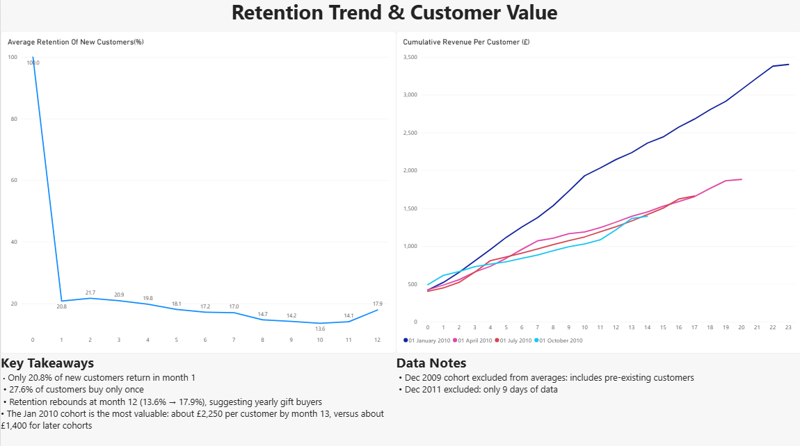

# Customer Retention & Lifetime Value Analysis

I wanted to answer two simple questions about an online store: **do customers come back after their first order, and how much is a customer actually worth over time?**

To find out, I did a cohort retention and customer lifetime value (CLV) analysis on two years of real transaction data using MySQL, then built a dashboard in Power BI.



## The short version

- The store had **5,878 customers** and about **£17.37M** in revenue over the two years.
- Only **20.8%** of new customers came back the month after their first purchase. Getting that second order is the store's biggest problem.
- But the customers who do stick around are valuable. On average a customer placed about **6 orders** and spent around **£2,956**.
- A lot of customers come back almost exactly **a year later**, which makes sense for a gift shop.

## The data

I used the [Online Retail II dataset](https://archive.ics.uci.edu/dataset/502/online+retail+ii) from the UCI Machine Learning Repository. It has every transaction from a UK-based online gift retailer between 1 Dec 2009 and 9 Dec 2011, which comes to just over 1 million rows. A lot of the customers are wholesalers, so some orders are really big.

The raw data isn't in this repo because the file is too large. You can download it from the link above.

*Citation: Chen, D. (2012). Online Retail II [Dataset]. UCI Machine Learning Repository. https://doi.org/10.24432/C5CG6D (CC BY 4.0)*

## Cleaning

The raw data needed some work before I could trust it. I removed:

- rows with no customer ID, since I can't track a customer I can't identify
- cancelled orders (invoice numbers starting with "C")
- rows where quantity or price was zero or negative
- exact duplicate rows

I also added a revenue column (quantity × price). After cleaning, I was left with **779,425 rows**, so roughly 27% of the original data got dropped.

## How I approached it

**Retention.** I grouped every customer by the month they first bought something. That group is their "cohort". Then for each cohort I counted how many customers bought again 1 month later, 2 months later, and so on, and turned that into a percentage. In SQL this meant using CTEs, `TIMESTAMPDIFF` to count months, and `FIRST_VALUE()` to get each cohort's starting size.

**Customer value.** I calculated orders, revenue and lifespan for each customer to get average order value and average lifetime value. I also tracked how much each cohort spent per customer over time using a running total (`SUM() OVER`).

## Two things I almost got wrong

When I first looked at the retention numbers, the very first cohort (Dec 2009) had about **35%** of customers coming back in month 1. The next few cohorts were only around **19–24%**. That gap seemed too big.

It turns out the data starts in Dec 2009, so that first "cohort" isn't really new customers. It includes regulars who had been buying for years before the data begins. That makes their retention look much better than it really is. I left this cohort out when calculating average retention.

The other issue was the last month. Dec 2011 only has 9 days of data, so every cohort looked like it suddenly collapsed at the end. That isn't real, so I left that month out of the averages too.

Without catching these, the dashboard would have told a misleading story.

## The dashboard

The first page shows the main numbers and a retention heatmap with one row per cohort. The second page shows the average retention curve for new customers and how much each cohort is worth over time.



## What I found

1. **Most new customers don't come back.** About 4 out of 5 don't make a second purchase the following month.
2. **There's a loyal core.** 72.4% of customers buy more than once, and they keep buying for months.
3. **Retention fades slowly after that.** It drifts from about 21% in the first few months down to 13.6% by month 10.
4. **Then it jumps back at month 12** (13.6% → 17.9%). People seem to come back for the same gift season the following year.
5. **November is huge.** Activity peaks before Christmas and drops off in the first few months of the year.
6. **Some cohorts are worth a lot more than others.** By month 13, customers from the Jan 2010 cohort had spent about £2,250 each, compared with roughly £1,400 for later cohorts.

## What I'd suggest to the business

- Focus on the second order. Something like a follow-up offer within 30 days of a first purchase could help a lot.
- Send a reminder around 11 months after someone's first order, just before they'd naturally come back.
- Plan stock and marketing around the November peak.

These are ideas based on the data, not proven fixes. They'd need to be tested properly (an A/B test, for example) before rolling them out.

## Limitations

- The average retention curve treats every cohort equally, so a small cohort counts as much as a big one. A weighted average would be another way to do it.
- A few very large wholesale customers push the average customer value up.
- Two years isn't a lot of data for predicting long-term customer value.

## What's in this repo

```
sql/          the SQL scripts, numbered in the order you run them
outputs/      query results exported for the dashboard
dashboard/    the Power BI file
images/       dashboard screenshots
```

If you want to run it yourself: download the dataset, save each Excel sheet as a CSV, update the file paths in `01_create_and_load.sql`, and run the SQL files in order in MySQL 8. Then open the `.pbix` file in Power BI Desktop.

## Tools

MySQL 8, MySQL Workbench, Power BI Desktop

---

Made by Sujal, a final-year B.Tech CSE student learning to become a data analyst. Feedback is always welcome.
